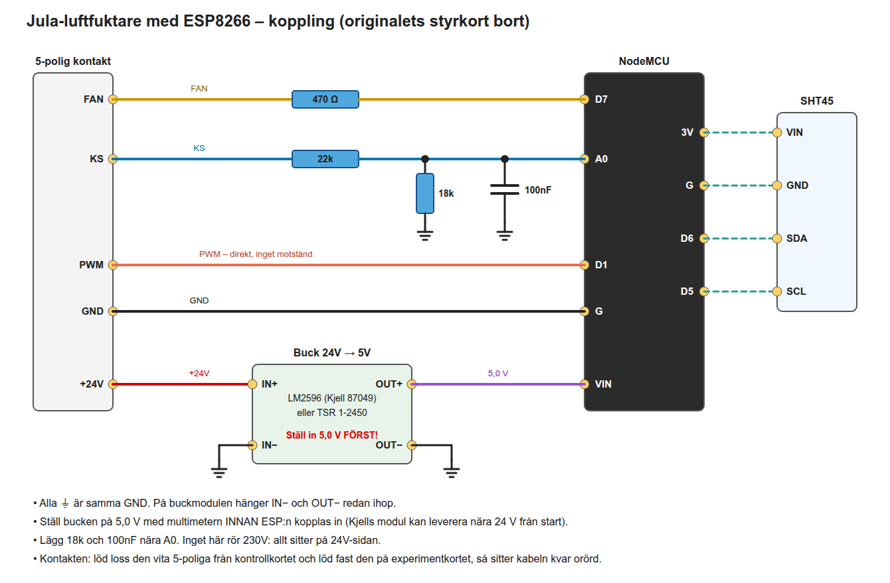
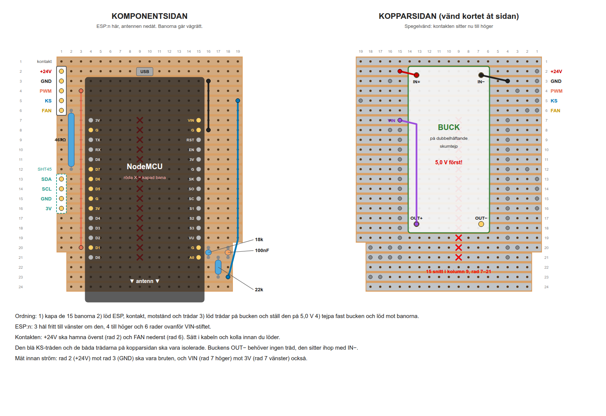

# Jula-luftfuktare med ESP8266 och ESPHome

Här byter jag styrkortet i en ultraljudsluftfuktare från Jula mot en ESP8266
(NodeMCU) med [ESPHome](https://esphome.io). Den står i ett odlingstält för svamp
och håller både luftfuktighet och temperatur.

<!-- TODO Jonas: modellnamn och artikelnummer från Jula -->

Originalet har tre fasta lägen och startar inte igen efter ett strömavbrott. Med
ESP:n:

- startar den själv efter strömavbrott och minns sina inställningar
- går dimman steglöst (25–80 %) och styrs av en PI-regulator mot en SHT45-givare
- går fläkten med dimman och 30 sekunder efter att den stängts av
- stannar den inom cirka 3 sekunder om tanken är tom, och väntar sedan tills
  någon trycker på "Tank påfylld"
- styr den en värmare via en Shelly Plug S Gen3, med självavstängning om något
  går fel
- syns och ställs allt i Home Assistant

## Säkerhet

- Luftfuktaren har 230 V inne i nätdelen. Allt i det här bygget sitter på
  24 V-sidan, men dra ur sladden innan du öppnar den.
- Ställ bucken på 5,0 V med multimeter **innan** ESP:n kopplas in. Modulen från
  Kjell kan ge nästan 24 V ut som den levereras, och det tål inte ESP:n.
- Värmaren ska ha eget överhettningsskydd. Shellyn och ESP:n är inget brandskydd.
- Du bygger på egen risk.

## Så fungerar originalet

Luftfuktaren har en nätdel som ger 24 V och ett styrkort (märkt XH-001-2 V1.1).
De hänger ihop med en vit 5-polig kontakt:

| Stift | Vad det gör |
|---|---|
| +24V | Matning från nätdelen |
| GND | Jord |
| PWM | Styr ultraljudsgivaren. Originalet kör 81 Hz med tre nivåer, högst cirka 79 % |
| KS | Återkoppling: cirka 0 V i vila, några volt när givaren går med vatten och överdel på plats. Faller till 0 när flottören säger tomt |
| FAN | 5 V-logik, hög = fläkten går |

Flottören sitter direkt på huvudkortet och ger bara klartecken när den står i
mitten, alltså när det finns vatten **och** överdelen sitter på.

Det finns ingen användbar 5 V på korten (styrkortet gör sin egen 5 V med en
linjärregulator och seriemotstånd), så ESP:n får ström från en egen buck på 24 V.

## Delar

| Del | Kommentar |
|---|---|
| NodeMCU ESP8266 | Jag använde LoLin V3 (stiftraderna 11 hål isär) |
| Buck-omvandlare LM2596, justerbar | Kjell art.nr 87049. Ställs på 5,0 V |
| SHT45-givare med kabel | Temperatur och luftfuktighet över I2C |
| 470 Ω | FAN-utgången (märkt 471) |
| 22 kΩ + 18 kΩ + 100 nF | Spänningsdelare och filter för KS |
| Stripboard (veroboard) | Cirka 19 × 24 hål räcker |
| 4-polig flygplanskontakt | Så att givaren kan kopplas loss |
| Kopplingstråd, krympslang, dubbelhäftande skumtejp | Skumtejpen isolerar bucken mot kortet |
| Shelly Plug S Gen3 + värmare | Valfritt, för värmen |

Den 5-poliga kontakten löder jag loss från originalkortet, så kabeln i
luftfuktaren kan sitta kvar orörd.

## Koppling



| NodeMCU | Till | Via |
|---|---|---|
| D1 | PWM | direkt |
| D7 | FAN | 470 Ω |
| A0 | KS | 22 kΩ i serie, 18 kΩ och 100 nF till GND vid A0 |
| D6 | SHT45 SDA | |
| D5 | SHT45 SCL | |
| 3V | SHT45 VCC | |
| VIN | Buckens OUT+ (5,0 V) | |
| G | GND | |

D3, D4 och D8 påverkar hur ESP:n bootar, TX/RX används av USB-porten och
S1–S3/SK/SO/SC går till flashminnet, så de lämnas fria.

A0 på en NodeMCU har redan en intern delare (220k/100k) för 0–3,2 V.
Tillsammans med 22k och 18k blir faktorn 7,33, men KS används bara som på/av,
så exakt skala spelar ingen roll.

## Stripboard



Banorna går vågrätt, alltså tvärs över ESP:ns stiftrader. Antennen pekar nedåt
och kontakten sitter längst till vänster.

1. Bryt banorna mellan ESP:ns två stiftrader (15 snitt). En 4 mm borr som du
   vrider för hand räcker.
2. Löd ESP:n, kontakten, motstånden och trådarna.
3. Löd trådar på bucken och ställ den på 5,0 V.
4. Tejpa fast bucken med dubbelhäftande skumtejp på kopparsidan, mellan
   stiftraderna, och löd trådarna mot banorna.
5. Mät innan du kopplar in 24 V: +24V mot GND ska inte ha kontakt, och inte VIN
   mot 3V heller.

Bucken behöver bara tre trådar: IN+ till +24V, IN− till GND och OUT+ till VIN.
IN− och OUT− hänger redan ihop på modulen.

## Givarkontakten

Givaren sitter på en 4-polig flygplanskontakt.

| Tråd | Signal | NodeMCU | Stift i kontakten |
|---|---|---|---|
| Röd | VCC | 3V | <!-- TODO Jonas --> |
| Svart | GND | G | |
| Grön | SDA | D6 | |
| Gul | SCL | D5 | |

Färgerna skiljer mellan tillverkare. Byter du plats på SDA och SCL händer inget
farligt, givaren svarar bara inte. Koppla VCC till **3V** och inte VIN, annars
dras I2C-ledningarna upp till 5 V mot ESP:n.

## Flasha

```bash
cp secrets.example.yaml secrets.yaml   # fyll i wifi och nya nycklar
uvx esphome run luftfuktare-styr.yaml  # första gången via USB, sedan via wifi
```

Ändra `shelly_ip` överst i `luftfuktare-styr.yaml` till din Shelly och ge den
fast IP i routern.

## I Home Assistant

| Entitet | Typ | Vad |
|---|---|---|
| Mål luftfuktighet | tal, 40–95 % | Vad regulatorn siktar på |
| Mål temperatur | tal, 15–30 °C | Vad värmen siktar på |
| Automatisk styrning | brytare | Av = dimman går på "Manuell dimma" |
| Manuell dimma | tal, 0–80 % | Används när automatiken är av |
| Värmestyrning | brytare | Av = värmen är alltid av |
| Tank påfylld | knapp | Startar igen efter "Tank tom" |
| Temperatur, Luftfuktighet | givare | Från SHT45 |
| Dimma | givare | Nuvarande nivå i % |
| Värme | på/av | Om värmen är beställd |
| Tank tom | problem | Tanken tog slut, väntar på knappen |
| KS | givare | Rå återkoppling från luftfuktaren |
| Kp, Ki | inställning | Regulatorns parametrar |

[`ha-dashboard.yaml`](ha-dashboard.yaml) är en färdig dashboard med allt ovan
och grafer för senaste dygnet. Klistra in den i råkonfigurationsredigeraren på
en ny dashboard. Entitetsnamnen förutsätter att enheten heter `luftfuktare` i
ESPHome.

Alla mål och lägen sparas i flash och överlever strömavbrott. ESP8266 skriver
till flash ungefär en gång i minuten, så en ändring precis före ett avbrott
kan gå förlorad.

## Regleringen

Var tionde sekund räknar regulatorn ut felet (mål minus uppmätt fukt) och sätter
dimman till `Kp × fel + integral`. Under 20 % stängs dimman av helt, eftersom
givaren knappt ger någon dimma där. Annars hålls den mellan 25 och 80 %.

Startvärdena är Kp = 8 och Ki = 0,02. Om fukten pendlar, sänk Kp. Om den lägger
sig under målet och stannar där, höj Ki.

Placera givaren i tältluften och inte i dimstrålen. Dimman kyler luften den
avdunstar i, så givaren visar för låg temperatur och för hög fukt om den sitter
för nära.

Om givaren tystnar i 60 sekunder stänger automatiken av dimman, och värmen
slås av.

## Tom tank

KS går bara högt medan givaren är igång. ESP:n kan alltså inte se att tanken är
tom förrän den har provat. Om KS ligger under 1 V i 3 sekunder medan dimman går
(tanken tom, flottören nere eller luftfuktaren uppochnedvänd) stängs dimman av
och "Tank tom" låses. Den står kvar även efter strömavbrott, tills någon trycker
på "Tank påfylld".

Med vatten i tanken går KS upp inom cirka 0,2 sekunder efter start, så 3
sekunder ger god marginal.

## Värmen

Värmaren är en liten frostvakt från Biltema (cirka 210 W). Den värmer först upp
sin egen kropp, så luften fortsätter bli varmare i 4–5 minuter efter att den
stängts av. En vanlig termostat med ±0,5 °C gav därför 23,8–27,8 °C.

ESP:n styr i stället med pulsbredd. Var tionde minut räknar en PI-regulator ut
hur stor del av fönstret värmen ska gå (Kp 0,1 och Ki 0,02 per °C), och Shellyn
får ett enda anrop:

```
http://<shelly>/rpc/Switch.Set?id=0&on=true&toggle_after=<sekunder>
```

Shellyn stänger alltså av sig själv när pulsen är slut. Om ESP:n, wifi eller
givaren slutar fungera går värmen högst en puls (8 minuter) till. Pulser under
30 sekunder hoppas över. Det blir cirka 140 starter per dygn, mot cirka 60 med
termostaten, men varje start är kort.

En puls är högst 80 % av fönstret. Utan taket gick värmen 10 minuter i sträck
från 19,5 °C och tältet slog över till 30 °C. Integralen växer inte medan
pulsen ligger i taket, så den lägger sig inte för högt under uppvärmningen.
Taket gör att värmen orkar hålla 25 °C ner till en källare på cirka 10 °C.
Integralen sparas inte, så efter en omstart i kyla tar det någon timme innan
den har hittat rätt nivå igen.

De första fyra timmarna med pulsstyrning höll tältet 24,6–25,5 °C, i medel
25,0 °C.

Ställ frostvaktens egen termostat på max, och se till att Shellyn är av efter
strömavbrott och inte har några egna scheman. Ett gammalt schema som slog på
klockan 08 gav mig 27 °C varje morgon.

## Kända begränsningar

- KS mäter olika med multimeter och ESP, och jag har inte redat ut varför. Den
  används bara som på/av, och det fungerar.
- Tom tank märks först efter en provkörning på högst 3 sekunder.
- Inställningarna sparas i flash med upp till en minuts fördröjning.

## Licens

MIT, se [LICENSE](LICENSE).
